# punto_venta_dolores

A new Flutter project.

## Getting Started

This project is a starting point for a Flutter application.

A few resources to get you started if this is your first Flutter project:

- [Learn Flutter](https://docs.flutter.dev/get-started/learn-flutter)
- [Write your first Flutter app](https://docs.flutter.dev/get-started/codelab)
- [Flutter learning resources](https://docs.flutter.dev/reference/learning-resources)

For help getting started with Flutter development, view the
[online documentation](https://docs.flutter.dev/), which offers tutorials,
samples, guidance on mobile development, and a full API reference.

Cap 1 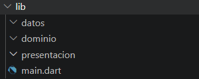
cap 2 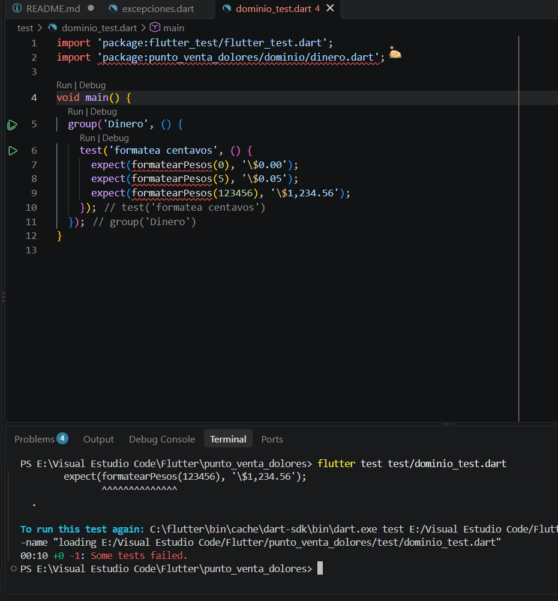
cap 3 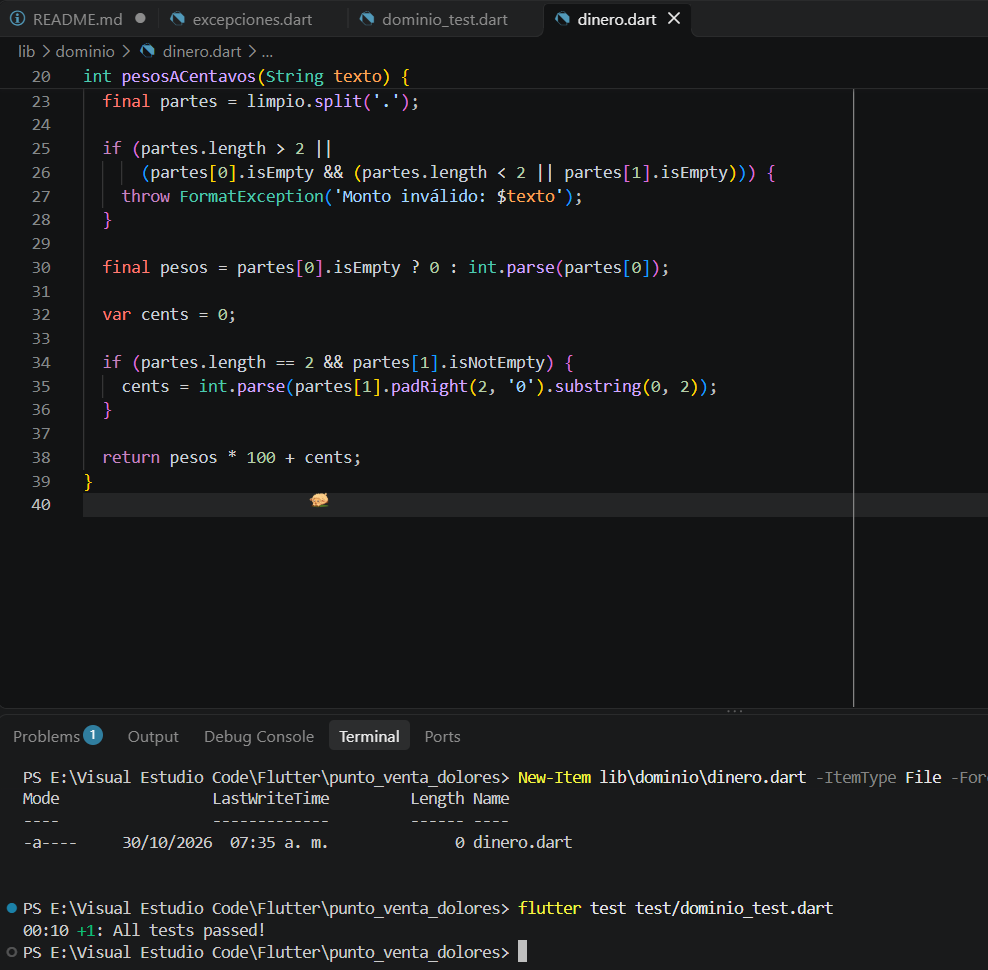
cap 4 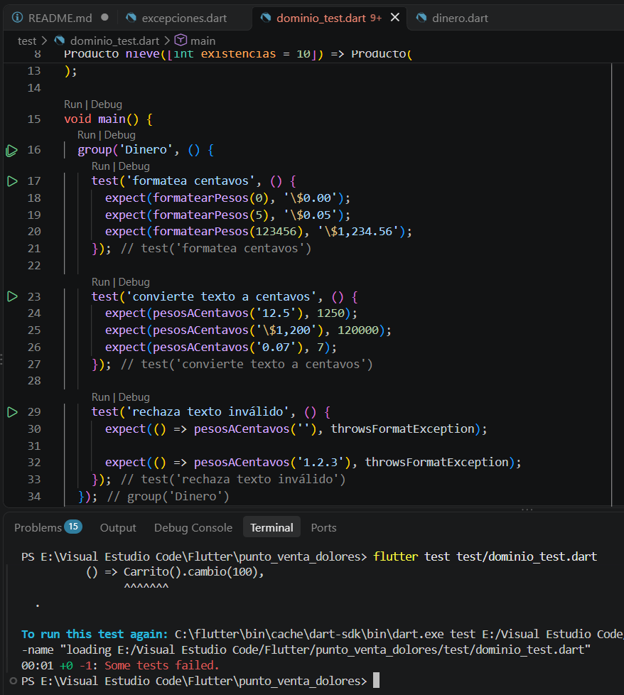
cap 5 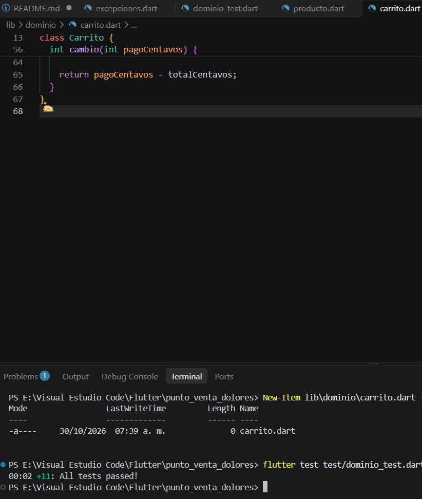
cap 6 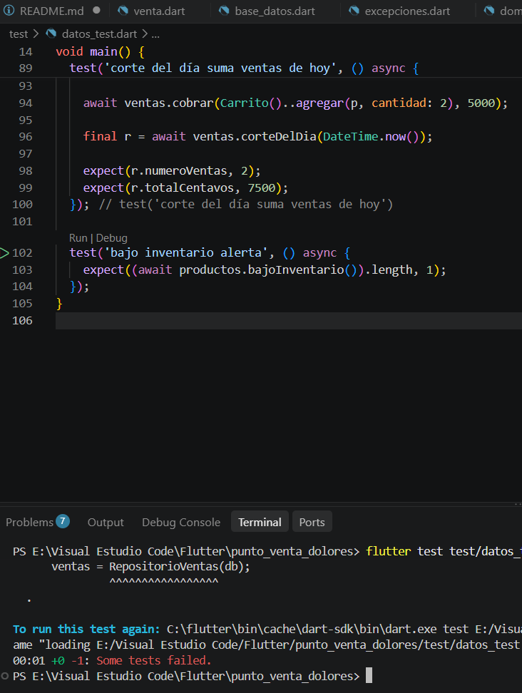
cap 7 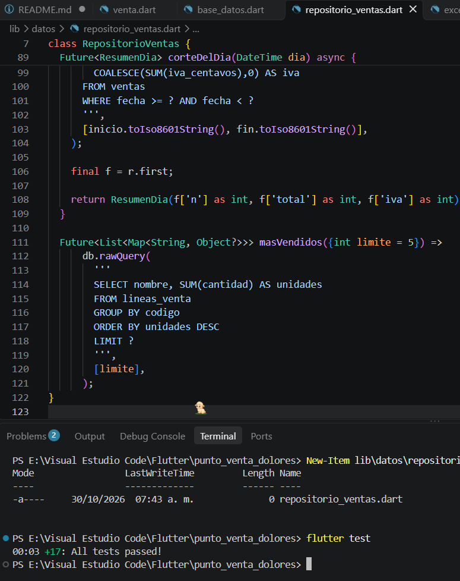
cap 8 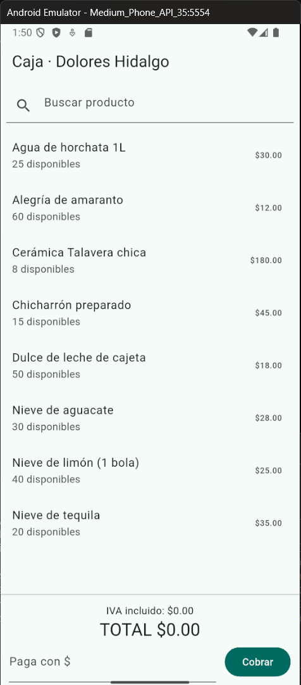
cap 9 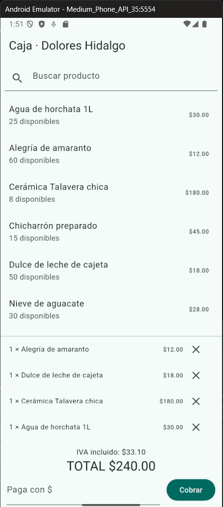
cap 10 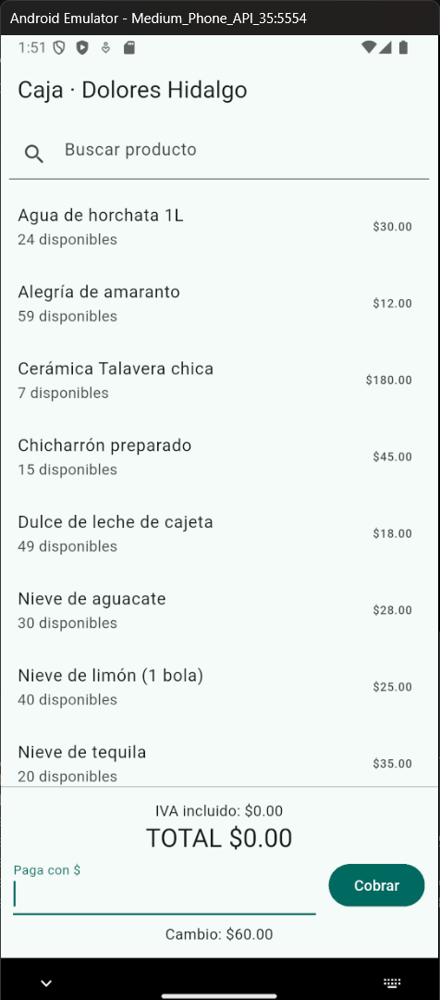
cap 11 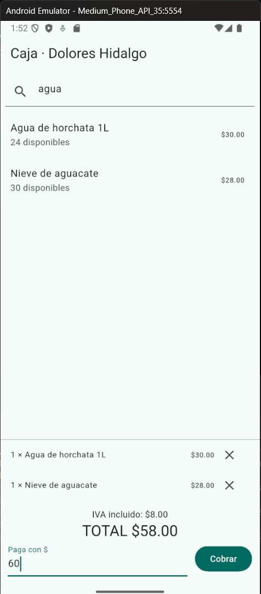
cap 12 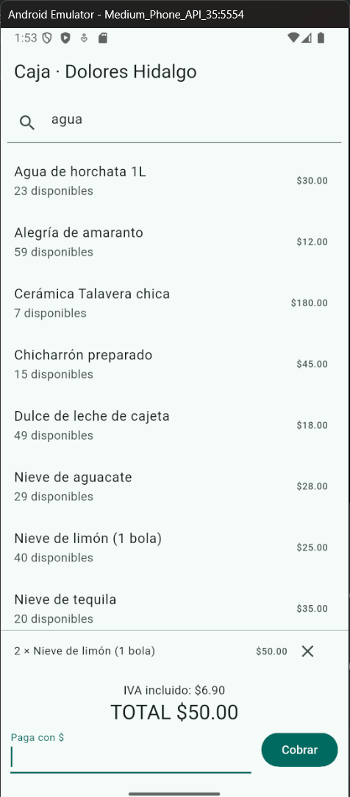
cap 13 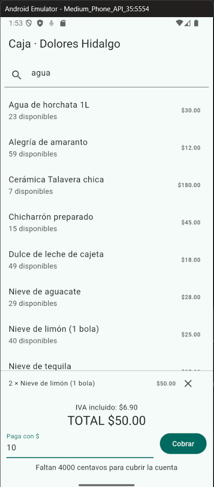
cap 14 